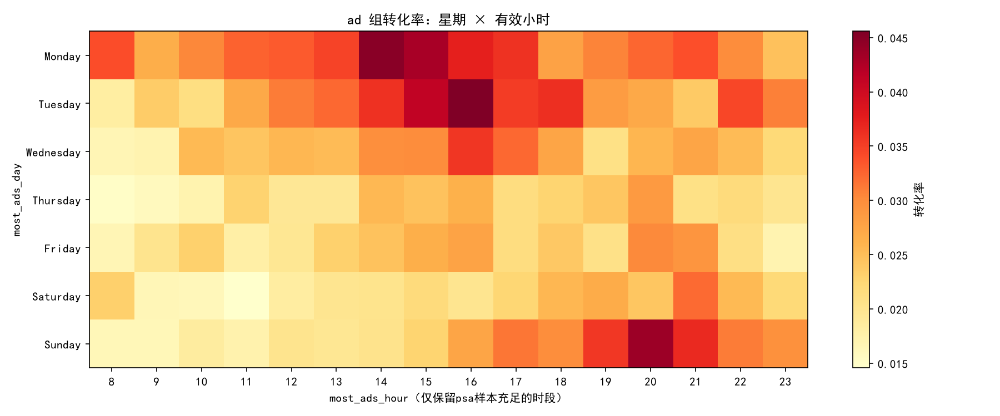

# 商业广告 A/B 实验与投放策略分析报告

## 1. 业务背景与分析目标
在数字营销中，评估广告投放的真实增量价值（Incrementality）是预算分配的核心依据。如果仅对比“投广告”与“不投广告”的用户，往往会因为“广告位本身带来的注意力”或“平台自然转化”产生混淆。
为了剥离这些干扰，本实验采用了 PSA（Public Service Announcement，公益广告）作为对照组。本项目基于 58.8 万级别的用户级广告曝光与转化数据，核心目标如下：
1. 验证商业广告相比公益广告，是否显著提升了用户的购买转化率。
2. 评估增量效应的大小（绝对与相对提升幅度），判断其业务价值。
3. 从时间维度（星期、小时）下钻，为广告主提供预算倾斜与投放时段优化的建议。

## 2. 数据概况与处理
*   **数据规模**：包含 588,101 名独立用户，无缺失值。
*   **实验分组**：
    *   **实验组（ad）**：564,577 人（占比 96%），曝光商业广告。
    *   **对照组（psa）**：23,524 人（占比 4%），曝光公益广告。
*   **核心指标**：`converted`（是否转化，二分类变量）。
*   **辅助维度**：`most_ads_day`（触达最多的一天）、`most_ads_hour`（触达最多的小时）。
*   **数据清洗**：移除了 CSV 冗余索引列，统一列名为下划线格式，验证了核心指标的分布无异常值。

## 3. 实验设计与前置校验
> **分析思路**：在跑显著性检验之前，必须先确认实验设计本身是否可信。

### 3.1 分流比例校验（SRM）
本实验并非传统的 50/50 等量分流，而是 96/4 的“小流量对照设计”。这是业务中为了控制机会成本（减少商业广告收入损失）的常见做法。
通过卡方拟合优度检验分情景分析：
*   假设预期 50/50：卡方检验 p≈0，强烈拒绝（因为实际不是 50/50）。
*   假设预期 96/4：卡方检验 **p=0.9998**，无法拒绝原假设。说明实际分流比例与设计高度一致，**分流系统无明显 Bug，数据可信**。

### 3.2 样本量敏感性分析
在单侧检验（业务假设具方向性）、95% 置信水平、80% 统计功效、最小可检测效应（MDE）为相对提升 20% 的设定下，通过 Statsmodels 计算得出每组所需的最小样本量为 **18,634 人**。
对照组实际样本量为 23,524 人，**满足主设定下的样本量要求**。即使采用更保守的双侧检验（需 23,656 人），实际样本量也仅差 132 人（约 0.56%），考虑到实际观测到的巨大效应量，检验功效完全不受实质影响。

## 4. 核心实验结论（主效应检验）
### 4.1 描述性统计与假设检验
*   实验组（ad）转化率：**2.5547%** (14,423/564,577)
*   对照组（psa）转化率：**1.7854%** (420/23,524)
*   采用**单侧两比例 Z 检验**（H0: ad 转化率 ≤ psa 转化率；H1: ad 转化率 > psa 转化率）：
    *   **Z 值**：7.3701
    *   **P 值**：8.53e-14（极小，远低于 0.05）

### 4.2 效应量与业务判断
*   **绝对提升**：**0.7692 个百分点** (95% CI: [0.5951, 0.9434] pp)。置信区间不包含 0，说明增量极其稳健。
*   **相对提升**：**43.09%**。

**业务判断**：商业广告带来的转化增量在统计上极显著，43.09% 的相对提升在业务上也非常可观。但需注意，这是相对公益广告的“相对增幅”，其绝对增量约为 0.77 个百分点。在实际落地时，需结合广告竞价成本（CPC/CPM）与客单价进行 ROI 测算，决定是否全量推。

## 5. 策略下钻：时间维度探索性分析
为回答“预算应在何时倾斜”，我们进行了维度下钻。**注意：此部分为描述性关联分析，非因果推断。**

### 5.1 星期效应
样本分布均匀，对照组的每日样本量在 2,800 - 3,900 之间，数据可靠。
*   **优势最大**：**周二**（差值 +1.60pp）、**周一**（+1.07pp）、周三（+0.96pp）。
*   **优势最弱**：**周四**（差值仅 +0.14pp），说明周四商业广告对用户的转化刺激极度微弱。

### 5.2 小时效应与小样本过滤
在直接按小时分组时，发现凌晨时段（0-7点）对照组转化率出现极端的 0%。经排查，这是**严重的小样本偏差**（如凌晨 4-6 点 psa 样本仅二三十人，转化 0 人）。
为防误判，我们建立了**“过滤规则”**：仅分析 psa 样本量 ≥ 500 且转化数 ≥ 5 的时段。
在过滤后的 16 个有效小时（8点-23点）中：
*   **优势最大**：**20 点**（+1.26pp）、**14 点**（+1.25pp）、22 点（+1.01pp）。
*   **优势最弱**：18 点（+0.23pp）、19 点（+0.23pp）、16 点（+0.28pp）。

  
  
<i>图 1：星期 × 有效小时（8-23点）广告组转化率热力图。颜色越深代表转化率越高。</i>

**热力图洞察**：结合星期与有效小时，**周一与周二的 14:00 - 16:00** 是转化率最深红的“黄金窗口”；而每周四全天表现都较为平淡，甚至在部分时段出现转化低谷。

## 6. 投放优化建议
1. **预算倾斜**：建议在**周一、周二、周三**加大预算，重点瞄准每天下午 **14:00 - 16:00** 以及晚间 **20:00** 的流量高峰期。
2. **素材与出价调整**：周四的转化增量极为微弱，可能是用户临近周末无心工作/购物。建议在周四降低出价，或更换为品牌种草类（非直接促转化）素材，减少预算浪费。
3. **避开低效时段**：每天的 18:00 - 19:00 广告优势最弱，若非抢占晚间品牌心智，可适当降低竞价频次。

## 7. 局限性与后续计划
1. **PSA 对照组的偏差**：由于现代广告算法会针对不同创意进行人群寻优，商业广告与公益广告的受众人群可能发生微妙偏移，存在一定的选择偏差（Selection Bias）。
2. **内生变量问题**：`total_ads`（曝光次数）受用户活跃度和平台竞价双重影响，存在内生性，因此本项目未直接利用曝光次数输出“增加 X 次曝光能提升多少转化”的因果结论。
3. **时间混杂**：时间维度的转化差异，极大可能是因为该时段活跃人群本身的购买属性就较强（如周末闲逛 vs 工作日午休摸鱼）。后续若需验证时间策略，需单独设计一个“控制出价、仅改变时段”的 A/B 实验。